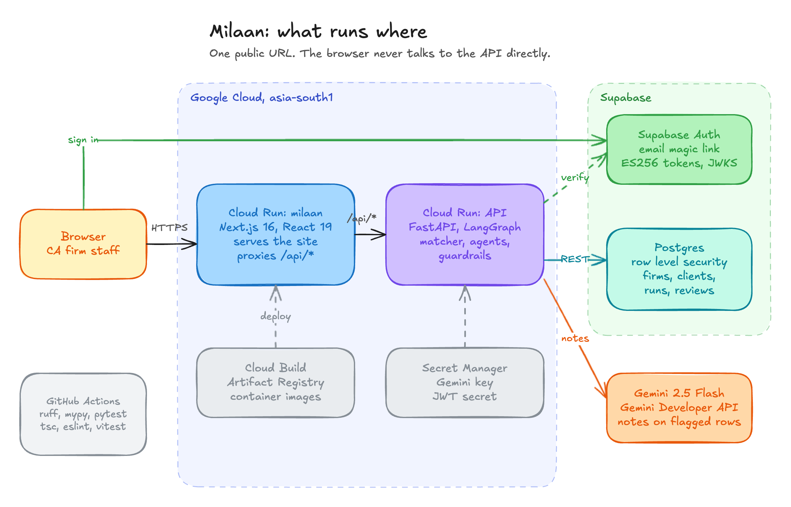
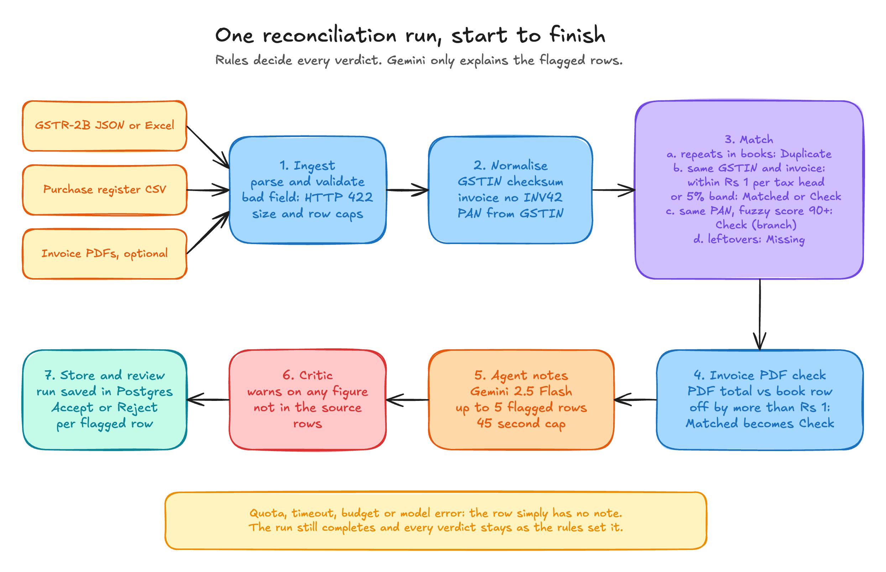
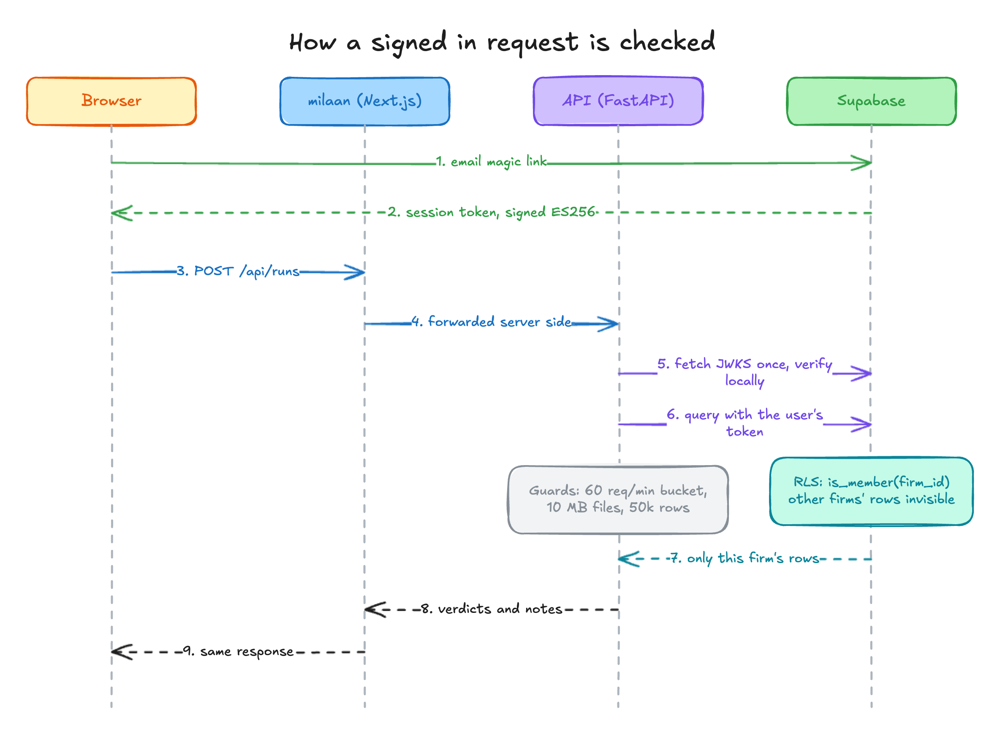

# Milaan

**Live:** https://milaan-321997950255.asia-south1.run.app

Milaan (Hindi for "match") reconciles a client's GSTR-2B against its purchase register and invoice PDFs. Every invoice gets a verdict from fixed rules. Gemini explains the rows that need a person, and the reviewer's accept or reject decision is saved with the run before input tax credit is claimed. Built for Indian CA firms.

Try it: sign in with an email link, add any test client, and upload the synthetic sample files linked from the home page. One sample PDF is deliberately ₹70 off, so a flagged row appears.

## The problem

Input tax credit can only be claimed when the supplier's invoice shows up in the buyer's GSTR-2B. Firms check this by sorting both lists in a spreadsheet, client by client, every month. Small differences break a lookup: `INV/0042` against `inv 42`, a supplier filing from another branch under the same PAN, a paise of rounding on one tax head, or the same bill keyed twice. Each one looks like a missing invoice until someone reads it.

## Architecture

The product has one public address. The Next.js app on Cloud Run serves every page and answers `/api/*` by forwarding the request, server side, to the FastAPI service. The browser therefore talks to a single origin, which removes CORS from the picture and keeps the API's address out of the JavaScript bundle; it is a runtime environment variable (`API_ORIGIN`) on the web service.

The API does the work: parsing, matching, the PDF check, the agent step and storage. It holds no database password. Every Postgres query goes through Supabase's REST interface with the signed in user's own token, so the database, not the application code, decides which rows that user may see.

Supabase provides two things: Auth (email magic links that issue ES256 signed session tokens) and Postgres with row level security. Gemini 2.5 Flash, through the Gemini Developer API, writes the notes on flagged rows. The Gemini key and the legacy JWT secret live in Secret Manager and are mounted into the API at deploy time. Images are built by Cloud Build into Artifact Registry. GitHub Actions runs lint, type checks and tests on every push.

## How a run works

1. **Ingest.** The GSTR-2B (portal JSON or Excel), the purchase register (CSV with a fixed column layout) and optional invoice PDFs are parsed into typed rows. A bad field returns HTTP 422 naming the field and row. Limits: 10 MB per file, 50,000 rows per run, 200 PDFs.
2. **Normalise.** GSTINs are checked against their mod 36 checksum. Invoice numbers are reduced to a canonical form (`INV/0042`, `inv 42` and `inv-42` all become `INV42`), cached with an LRU cache because the same numbers recur. The PAN is taken from characters 3 to 12 of each GSTIN.
3. **Match.** Four passes, in order:
   - a repeated GSTIN and invoice key inside the books is a **Duplicate**;
   - the same GSTIN and canonical invoice number is compared head by head (IGST, CGST, SGST, cess). Every head within ₹1 is **Matched**; a total gap within 5% is **Check** with the reason `amount_gap`; a date more than a month from the return period adds `date_out_of_window`;
   - leftovers are grouped by PAN, and a fuzzy invoice score of 90 or more with the same taxable value is **Check** with `gstin_branch`;
   - whatever is still unpaired is **Missing**, in the 2B or in the books.
4. **Invoice PDF check.** Text is pulled from each PDF with pdfplumber. Its invoice number and supplier GSTIN find the book row, and its total is compared with that row's taxable value plus tax. A gap above ₹1 turns Matched into Check with `invoice_total_mismatch`. PDFs without a text layer are marked for OCR instead of guessed.
5. **Agent notes.** Up to five flagged rows go to Gemini 2.5 Flash with a fixed schema: likely cause, explanation, suggested action. Five is the free tier's per minute quota, and the whole step has a 45 second ceiling. Document text is wrapped and stripped of instruction-like lines before it reaches the model.
6. **Critic.** A deterministic check reads every number in each note and warns when one does not appear in the source rows (invoice numbers, GSTINs and dates are excluded). The warning is shown next to the note.
7. **Store and review.** The run, its rows, notes and verdict counts are written to Postgres. The reviewer accepts or rejects each flagged row; decisions are an append only log, and the latest one per row is shown.

The verdict is final after step 4. If Gemini is unavailable, over quota, over the firm's daily budget, or returns something that fails its schema, that row simply has no note and the run still completes.

## How a request is checked

1. The user asks Supabase for a magic link and opens it. Supabase returns a session token signed with ES256.
2. The browser calls `/api/...` on the same origin with that token. Next.js forwards it to the API.
3. The API fetches Supabase's public keys (JWKS) once, caches them, and verifies the token's signature, audience and expiry locally. HS256 tokens are still accepted for tests.
4. The API queries Postgres through PostgREST using the user's token. Row level security policies (`is_member(firm_id)`) hide every other firm's clients, runs and reviews, even if the application code had a bug.
5. Before any of that, a token bucket limits each caller to a burst of 60 requests refilled at one per second, and file size and row caps reject oversized uploads.

## Tech stack

| Layer | Products and libraries | What they do here |
|---|---|---|
| Web | Next.js 16 (App Router), React 19, Tailwind CSS 4 | Pages, the `/api` proxy route, server rendered landing page |
| Web UI | Manrope, Geist Mono, Phosphor icons | Type and icons; amounts set in a monospace face |
| Web tests | Vitest, Testing Library, ESLint, TypeScript | Component and helper tests, lint and type checks |
| API | Python 3.12, FastAPI, Pydantic 2, Uvicorn | Typed endpoints and request validation |
| Matching | RapidFuzz, Python `Decimal` | Fuzzy invoice scores; exact money arithmetic |
| Documents | pdfplumber, openpyxl | Invoice PDF text, GSTR-2B Excel files |
| Agents | Google Gen AI SDK, Gemini 2.5 Flash, LangGraph | Structured notes on flagged rows; the batch pipeline with checkpoints |
| Auth | Supabase Auth, PyJWT with JWKS | Email magic links, ES256 token verification |
| Data | Supabase Postgres, PostgREST, row level security | Firms, clients, runs, reviews, isolated per firm |
| Cloud | Cloud Run, Cloud Build, Artifact Registry, Secret Manager | Two services in asia-south1, image builds, secrets |
| Quality | pytest, ruff, mypy, GitHub Actions | 84 API tests, 35 web tests, lint and types on every push |

## Guardrails

- No free form chat. Every endpoint is typed, and the row question endpoint refuses anything a scope gate does not recognise as GST work.
- Document text is treated as data: instruction-like lines are removed and the rest is wrapped before a model sees it.
- PAN and phone numbers are masked in text sent to models.
- Each firm has a daily token and rupee budget for model calls; past it, runs fall back to rules only.
- The model never computes amounts and never sets a verdict.

## Performance

Synthetic load only, with a fake LLM so model latency does not hide matcher cost. Accuracy is not scored on synthetic data. Full log: [`services/api/benchmarks/results/LOG.md`](services/api/benchmarks/results/LOG.md).

| Round | Change | Size | Stage | Before | After |
|---|---|---|---|---|---|
| 1 | Index books by PAN; compute keys once | 20k invoices | match | 1,522 ms | 222 ms |
| 1 | same | 20k invoices | end-to-end pipeline | 1,912 ms | 613 ms |
| 2 | Keep pipeline inputs out of checkpointed state | 20k invoices | end-to-end pipeline | 613 ms | 425 ms |
| 3 | Precompile and cache invoice-number canonicalisation | 20k invoices | end-to-end pipeline | 444 ms | 370 ms |

Reproduce: `cd services/api && uv run python -m benchmarks.run --size 20000`

## Status

| Area | State |
|---|---|
| Ingest (GSTR-2B JSON and Excel, purchase register CSV, invoice PDF) | Built, tested; invoice PDFs are parsed and their totals checked against matching book rows (reported, verdicts unchanged) |
| Normalisation and matcher | Built, tested |
| LangGraph pipeline, budgets, checkpoints | Built, tested (fake LLM) |
| Guardrails (scope, PII, rate limit, injection stripping) | Built, tested as logic; not yet wired into all HTTP routes |
| Auth, run, row-question and review endpoints | Built, tested. Clients and runs persist in Supabase through its REST API with the user's own token, so row-level security scopes every query |
| Supabase schema and row-level security | Built and verified against a local Supabase: 4 RLS tests pass (cross-firm reads and writes blocked) |
| Legal corpus RAG | Built with a hash embedder; corpus text is paraphrased and awaits verification |
| Web app: landing page, sign in, clients, new run, reconciliation and review | Built, tested (35 web tests), deployed |
| Google and email sign-in end to end | Email magic-link sign-in verified in the deployed app; session tokens (ES256) are checked against the project JWKS. Google OAuth client not configured |
| Live agent notes and review | Each run sends up to 5 flagged rows to Gemini 2.5 Flash for a cause and suggested action; a deterministic critic flags any figure not in the source rows. Agents never change a verdict; quota or errors leave rows unexplained and the run still completes. Reviewers accept or reject flagged rows; decisions are stored with the run. Verified in the deployed app: a live Gemini note on a flagged row, and an Accept decision that survives a reload |
| Cloud Run deploy | One public URL; verified in a browser: add a client, upload the three files, get verdicts with reasons and notes, review, reload from the database |
| ITC eligibility and supplier reminder agents | Built and unit tested in the pipeline; not yet called from live runs |

## Development

- API: `cd services/api && uv sync && uv run pytest && uv run ruff check . && uv run mypy app`
- Web: `cd apps/web && pnpm install && pnpm test && pnpm build`

## Editing the diagrams

The diagrams are drawn in Excalidraw. Each PNG sits next to its `.excalidraw` source in `docs/diagrams/`; open the source at excalidraw.com, edit, and export a PNG at 2x scale over the old one.
